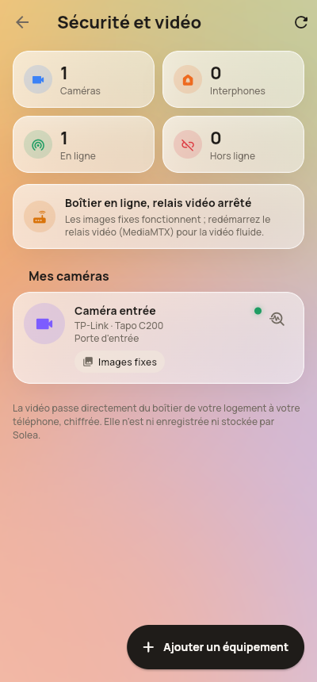
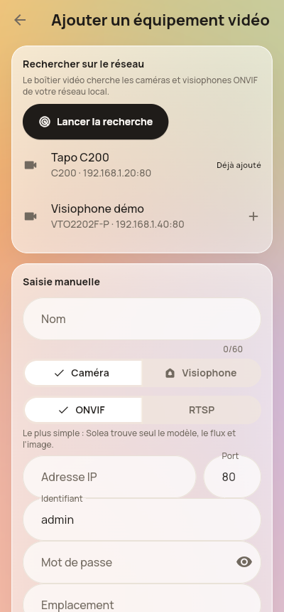
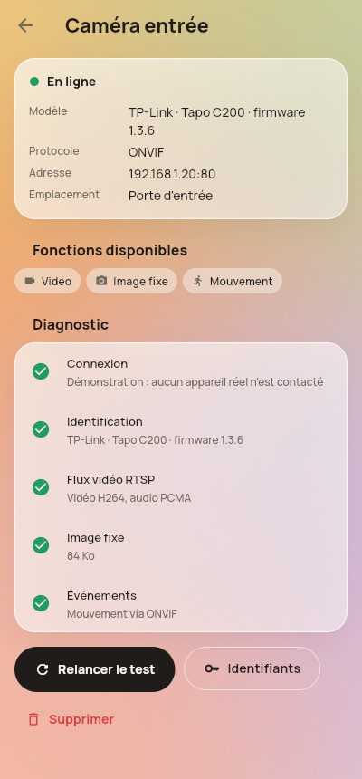

# Sécurité et vidéo : caméras et visiophones (phase A)

  

Ce guide explique, simplement, ce que fait la première étape du module **Solea Smart Intercom
& Video Security** et comment l'installer. Les appels (SIP), l'ouverture de porte par le
visiophone et les fabricants un par un viendront aux phases suivantes.

## Ce que fait la phase A

- **Ajouter une caméra ou un visiophone** depuis Solea : *Paramètres › Sécurité et vidéo ›
  Ajouter un équipement*. Deux façons :
  - **Rechercher sur le réseau** : le boîtier vidéo trouve tout seul les appareils ONVIF.
  - **Saisie manuelle** : adresse IP (ONVIF) ou adresse du flux (RTSP).
- **Diagnostic automatique** après l'ajout : connexion, marque, modèle, firmware, profils
  ONVIF, flux RTSP, image fixe, événements. Chaque étape est affichée ✓ ou ✗.
- **Vidéo fluide en direct** (WebRTC), avec le son si la caméra a un micro compatible.
  HD / SD, plein écran, zoom. Si la vidéo fluide n'est pas possible : images fixes.
- **Détection de mouvement** (ONVIF) : elle apparaît dans la fiche et peut déclencher une
  automatisation (« mouvement à l'entrée la nuit → allumer la lumière »).
- **Villas et immeubles** : un logement peut être rattaché à un immeuble (résidence,
  bâtiment, entrées), avec un gestionnaire et des agents de sécurité. Les écrans de gestion
  des immeubles arrivent en phase C ; la base est prête.

**Honnêteté des fonctions** : Solea n'affiche que ce que l'appareil sait vraiment faire et
que Solea sait piloter. Exemple : un relais de porte détecté sur un visiophone est signalé
(« ouverture de porte avec l'interphonie »), mais aucun bouton « Ouvrir » n'apparaît avant la
phase B.

## Pourquoi un boîtier sur place

Les caméras sont sur le réseau de la maison. Le serveur Solea (ADEX) est ailleurs : il ne les
voit pas. Il faut donc **un petit boîtier dans chaque villa ou immeuble**, branché sur le même
réseau que les caméras :

- Raspberry Pi 5 (4 Go) avec carte microSD ou SSD, ou n'importe quel mini-PC sous Linux.
- Câble Ethernet vers la box ou le switch des caméras (le Wi-Fi marche, l'Ethernet est plus sûr).

Le boîtier contient la passerelle Solea (mode `video`) et **MediaMTX**, le relais vidéo.

```
 Téléphone ── WebRTC chiffré ──▶ Boîtier (MediaMTX) ── RTSP local ──▶ Caméra
     │                                 ▲
     └── offre / réponse via Solea ────┘   (aucun port ouvert, aucune adresse RTSP exposée)
```

## Matériel conseillé (sans abonnement)

Prenez des appareils qui marchent **en local** avec des protocoles standards. Sur la fiche
produit, cherchez : **ONVIF (Profile S)**, **RTSP**, et **SIP** pour un visiophone.

| Type | Exemples | À éviter |
|---|---|---|
| Caméra | Hikvision DS-2CD1xxx, Dahua IPC-HDW / HFW (PoE) | Ezviz, Imou, Tapo, Ring (pensées pour leur cloud) |
| Visiophone | Akuvox R20A, Dahua VTO2202F-P | modèles « app uniquement » sans SIP |

Ces exemples sont **à vérifier sur le vrai matériel** : aucun n'a encore été testé avec Solea.

Réglages à faire dans la caméra (page web de la caméra) :
1. Activer **ONVIF** et créer un utilisateur ONVIF (souvent distinct du compte admin).
2. Mettre la caméra **à l'heure** (NTP) : ONVIF refuse les connexions si l'heure est fausse.
3. Pour le son : choisir l'audio **G.711** (PCMU/PCMA). L'AAC n'est pas lisible en WebRTC.

## Installer le boîtier

1. Dans Solea : *Paramètres › Intégrations › Ajouter › Autre*, nommez-la « Boîtier vidéo ».
   Copiez son identifiant.
2. Sur le boîtier (Docker installé) :
   ```
   cd bridge
   cp .env.video.example .env       # compléter SUPABASE_URL, SUPABASE_SERVICE_ROLE_KEY, INTEGRATION_ID
   docker compose -f docker-compose.video.yml up -d
   docker compose -f docker-compose.video.yml logs -f bridge
   ```
3. Dans Solea : *Paramètres › Sécurité et vidéo*. La carte « Boîtier vidéo en ligne » doit
   apparaître en moins d'une minute.
4. *Ajouter un équipement › Lancer la recherche*, choisir la caméra, saisir l'identifiant et le
   mot de passe, *Ajouter et tester*.

Le boîtier peut tourner **en même temps** que la passerelle principale (Tuya, TTLock, serveur
ADEX) : il ne gère que les caméras et visiophones. Il exécute les automatisations déclenchées par
ses appareils (mouvement) ; les automatisations horaires restent à la passerelle principale.

### Vidéo hors de la maison (4G, autre Wi-Fi)

Par défaut, un serveur STUN public suffit dans la plupart des cas. Certains réseaux mobiles
bloquent les connexions directes : il faut alors un **relais TURN** (logiciel coturn) sur le
serveur de l'exploitant, configuré avec `use-auth-secret`. Renseignez `VIDEO_TURN_URLS` et
`VIDEO_TURN_SECRET` dans le `.env` du boîtier : l'application ne reçoit que des identifiants
valables 6 heures, jamais le secret.

## Sécurité

- Les **mots de passe des caméras** vont dans une table que l'application ne peut pas lire ;
  seul le boîtier les lit. Un résident ou un membre ne voit ni l'adresse IP ni le mot de passe.
- Les **adresses RTSP ne sortent jamais** du boîtier. MediaMTX n'écoute que sur la machine
  elle-même ; seul le média WebRTC (chiffré DTLS-SRTP) circule.
- Un membre limité à certains appareils ne peut ouvrir la vidéo que des caméras autorisées.
  **Un voisin ne peut jamais ouvrir la caméra d'un autre logement** (vérifié par les tests SQL).
- **Aucun enregistrement** : la vidéo n'est ni enregistrée ni stockée par Solea.
- La recherche réseau est limitée aux réseaux privés (ou à `VIDEO_SUBNETS`).
- Recommandé : mettre les caméras sur un réseau (VLAN) séparé quand l'installation le permet.

## Ce qui n'est pas encore fait (phases suivantes)

| Fonction | Phase |
|---|---|
| Appels du visiophone (SIP, Asterisk), réponse, refus, appels manqués | B |
| Notifications d'appel en arrière-plan (Android, iOS) | B (projet Firebase et compte Apple Developer nécessaires) |
| Ouverture de porte par le relais du visiophone | B |
| Adaptateurs Akuvox, Hikvision ISAPI, Dahua CGI, 2N | B (un vrai appareil par marque pour valider) |
| Parler à la caméra (haut-parleur), PTZ | B / C |
| Écrans de gestion des immeubles, historique, bibliothèque d'images | C |
| Topics MQTT `solea/…` | B, si Mosquitto est installé |

## Tests

- Passerelle : `cd bridge && npm test` (caméra ONVIF simulée, serveur RTSP local, relais
  MediaMTX simulé, isolation des pannes, automatisation sur mouvement).
- Base : `supabase/tests/test_video.sql` (droits, secrets, sessions vidéo, immeubles).
- Application : `cd app && flutter test` (écrans Sécurité, ajout, diagnostic).

**Non testé** : une vraie caméra, un vrai MediaMTX et la vidéo WebRTC sur un vrai téléphone. Ce
sera le premier essai dès que le matériel est là.
